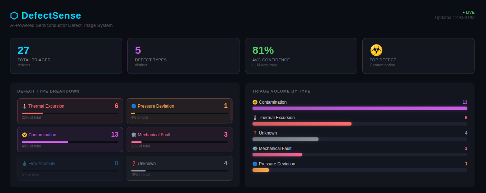
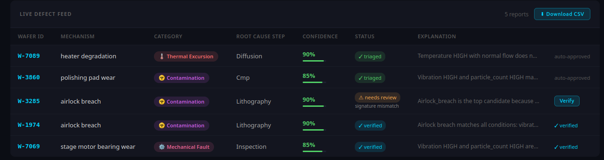

# DefectSense — AI-Powered Semiconductor Defect Triage System

An event-driven system that ingests sensor data from semiconductor process equipment,
detects anomalies deterministically, and uses an LLM (local via Ollama, or cloud via
Groq — swappable through LiteLLM) to diagnose the underlying failure *mechanism* (not
just a broad category) by reasoning over multiple sensor signals, an operator note, and
past verified cases — with four deterministic guardrails (two on the model's output,
two on the operator-supplied input) deciding whether a diagnosis is safe to auto-triage
or needs a human to review it.

---

## Dashboard


*KPI cards (triaged/needs-review/verified/model accuracy) + category breakdown.*


*Live report table — auto-approved `triaged` rows show no action needed; `needs_review`
rows show why (e.g. "signature mismatch") alongside a Verify button.*

---

## Architecture

```
Sensor Events
     │
     ▼
FastAPI (POST /ingest/event)
     │  BackgroundTask
     ▼
Redis Stream (defect-events)
     │  XREAD blocking
     ▼
Prefect Worker
     ├── detect_anomalies    → rule-based (non-LLM): label every sensor
     │                          normal / slightly_high / slightly_low / HIGH / LOW
     │                          against fixed limits; skip if nothing alarms
     ├── classify_defect     → input guardrails sanitize operator_note (injection/PII),
     │                          RAG (defect_history in Qdrant) + LLM via LiteLLM
     │                          (Ollama or Groq), schema-constrained output, diagnoses
     │                          one of 18 mechanisms + unrecognized_pattern
     ├── trace_process_chain → NetworkX graph: downstream impact always,
     │                          upstream origin search only for upstream_contamination
     └── generate_report     → repair checklist (code lookup, never LLM-generated),
                                seen_before / recurrence_count from verified history,
                                triaged vs needs_review from 4 guardrails + confidence
     │
     ▼
Redis (defect:reports hash + insertion-order list, capped at MAX_REPORTS)
     │
     ▼
FastAPI (GET /reports, /reports/stats, /mechanisms, POST /reports/{id}/verify)
     │
     ▼
React Dashboard (polls every 3s)
```

An engineer verifying a report (confirm or correct the mechanism) is what writes back
into `defect_history` — the model only ever learns from human-confirmed outcomes, never
from its own unverified guesses.

---

## Tech Stack

| Layer | Technology | Why |
|---|---|---|
| API | FastAPI + BackgroundTasks | Async ingestion, non-blocking |
| Message Queue | Redis Streams | Persistent event log, right-sized (vs Kafka) |
| AI Pipeline | Prefect | Workflow orchestration with retries + state tracking |
| LLM Gateway | LiteLLM | One call shape for both providers below — see *Provider Choice* |
| LLM | Ollama `llama3.2:3b` (default, local) or Groq `qwen/qwen3.8-27b` (cloud) | Swappable via `LLM_PROVIDER` — see *Provider Choice* below |
| Vector DB | Qdrant | RAG over verified defect history — see *Vector DB Choice* below |
| Config | pydantic-settings | One typed, validated `Settings` object instead of scattered `os.getenv()` |
| Observability | Langfuse (optional, off by default) | Traces every diagnosis call — prompt, response, latency, cost, errors |
| Process Graph | NetworkX DiGraph | Semiconductor process chain traversal |
| Frontend | React + Vite + nginx | Live dashboard, polled every 3s |
| Containerization | Docker Compose | One-command startup for all services |

---

## Semiconductor Process Chain

```
deposition → cmp → lithography → etching → wet_clean → diffusion → inspection → metrology
```

For each anomaly, the system traces:
- **Downstream impact** (BFS forward, depth 2) — always computed, shown as a repair-checklist item ("re-inspect wafers downstream of X")
- **Possible origin steps** (BFS backward) — computed *only* when the diagnosed mechanism is `upstream_contamination`; every other mechanism's root cause is the step where it was detected (a local fault doesn't need an upstream search)

---

## Defect Taxonomy

Each sensor no longer maps 1:1 to a defect type — that made the LLM a lookup table.
Instead, `category` is a 5-way rollup used for reporting, and `mechanism` is one of 18
specific failure modes (+ `unrecognized_pattern`) the LLM diagnoses by checking each
candidate's required sensor signature against the labeled readings for the event's
specific process step (2-4 candidates shown at a time, not all 18):

| Category | Example mechanisms |
|---|---|
| `pressure_deviation` | chamber_seal_leak, exhaust_valve_blockage |
| `thermal_excursion` | coolant_restriction, heater_degradation |
| `contamination` | polishing_pad_wear, chemical_bath_contamination, upstream_contamination |
| `mechanical_fault` | head_bearing_wear, stage_motor_bearing_wear |
| `flow_anomaly` | gas_line_restriction, mfc_drift, purge_gas_failure |
| `unclassified` | unrecognized_pattern — none of the step's known mechanisms match |

Full taxonomy (id, category, step, sensor signature) is served at `GET /mechanisms`
and defined once in `core/mechanisms.py`.

---

## Project Structure

```
defectsense/
├── api/
│   ├── main.py          # FastAPI app + CORS
│   └── routes.py        # /ingest/event, /reports*, /mechanisms, /reports/{id}/verify
├── core/
│   ├── models.py         # Pydantic models: SensorEvent, MechanismEnum, DefectReport
│   ├── settings.py        # Centralized pydantic-settings config (LLM provider, Redis, Qdrant, etc.)
│   ├── limits.py          # Sensor limits + label_reading/label_all_readings/has_alarm
│   ├── mechanisms.py      # Mechanism taxonomy, category/repair lookups, distinguishing checks
│   ├── redis_client.py    # Redis Stream push/read
│   ├── vectorstore.py     # Qdrant upsert/search/get_all + fetch_seen_before
│   ├── graph_store.py     # NetworkX process chain (downstream + upstream BFS)
│   └── report_store.py    # Redis-backed report store, capped at MAX_REPORTS
├── pipeline/
│   ├── flows.py          # Prefect flow: detect → classify → trace → report
│   │                      # 4 guardrails live here: 2 on LLM output (signature
│   │                      # consistency, self-contradiction), 2 on operator_note
│   │                      # input (prompt-injection, PII) before it reaches the prompt
│   ├── prompts.py        # Diagnosis prompt builder (shuffled candidates, worked examples)
│   └── worker.py         # Redis Stream consumer loop
├── ingest/
│   ├── generator.py      # Simulated sensor event producer + designed note-disambiguation cases
├── scripts/
│   └── smoke_diagnosis.py # Direct detect+diagnose test, no Redis/Prefect — for checking model quality
├── dashboard/            # React + Vite frontend
├── assets/               # Screenshots
├── Dockerfile            # API + Worker (Python 3.11)
├── Dockerfile.dashboard  # React build → nginx (multi-stage)
└── docker-compose.yml    # All 5 services (redis, qdrant, api, worker, dashboard)
```

---

## Running Locally

### Prerequisites
- Python 3.11+
- Node 18+
- Redis
- [Qdrant](https://qdrant.tech) — `docker run -p 6333:6333 -v $(pwd)/.data/qdrant:/qdrant/storage qdrant/qdrant`
- [Ollama](https://ollama.com) with `llama3.2:3b` and `nomic-embed-text` pulled

```bash
ollama pull llama3.2:3b
ollama pull nomic-embed-text
```

### Setup

```bash
cd defectsense
python -m venv .venv && source .venv/bin/activate
pip install -r requirements.txt
```

### Configuration (optional)

All config has sane local defaults (`core/settings.py`) — no `.env` needed to run locally
against Ollama. Create one only if you want to override something:

```bash
# .env — all optional
LLM_PROVIDER=groq              # default: ollama
GROQ_API_KEY=...               # required if LLM_PROVIDER=groq
GROQ_MODEL=...                 # default: llama-3.3-70b-versatile
QDRANT_URL=...                 # default: http://localhost:6333
LANGFUSE_PUBLIC_KEY=...        # tracing stays off unless both Langfuse keys are set
LANGFUSE_SECRET_KEY=...
```

### Start Services (5 terminals)

```bash
# Terminal 1 — Redis
redis-server

# Terminal 2 — Qdrant
docker run -p 6333:6333 -v $(pwd)/.data/qdrant:/qdrant/storage qdrant/qdrant

# Terminal 3 — API
python -m api.main

# Terminal 4 — Worker
python -m pipeline.worker

# Terminal 5 — Dashboard
cd dashboard && npm install && npm run dev
```

Or skip terminals 1-2 and just run `make dev` after Redis + Qdrant are up (starts api,
worker, and dashboard together — see `Makefile`).

### Generate Events

```bash
python -m ingest.generator
```

Open `http://localhost:5173` — dashboard auto-refreshes every 3 seconds.

### Quick model-quality check (no services needed)

```bash
python scripts/smoke_diagnosis.py            # N_EVENTS=20 by default, fresh random sample each run
N_EVENTS=15 python scripts/smoke_diagnosis.py
LLM_MODEL=llama3.2:3b N_EVENTS=15 python scripts/smoke_diagnosis.py
```

### Formal eval suite (fixed 40-event dataset, ~20 min)

```bash
python evals/run_eval.py                     # accuracy, confusion matrix, calibration, guardrail stats
LLM_MODEL=qwen2.5:3b python evals/run_eval.py  # compare another model on the same fixed set
```

See `evals/README.md` for the dataset design and full metric definitions.

---

## Running with Docker

```bash
docker compose up --build
```

| Service | URL |
|---|---|
| Dashboard | http://localhost:80 |
| API | http://localhost:8000 |
| API Docs | http://localhost:8000/docs |
| Qdrant Dashboard | http://localhost:6333/dashboard |

Then in a separate terminal:
```bash
source .venv/bin/activate
python -m ingest.generator
```

---

## Key Engineering Decisions

**Server-side, rule-based anomaly detection.** Sensor readings are labeled
(`normal` / `slightly_high` / `slightly_low` / `HIGH` / `LOW`) in plain Python against
fixed limits *before* the LLM ever sees the event — the LLM never decides whether
something is anomalous, only *why*, given readings that are already known to be
abnormal. This mirrors how a real fab tool would flag a threshold breach.

**Schema-constrained LLM output via LiteLLM, per-provider.** Ollama's `response_format`
(json_schema envelope) is unwrapped by LiteLLM straight into Ollama's own native
grammar-constrained `format` param — verified by reading LiteLLM's Ollama transformation
source directly, not assumed: real token-level enforcement, not just "the model was
asked nicely." Groq doesn't support that mechanism, so Groq gets tool-calling with the
same schema as the function's parameters instead — different mechanism, same guarantee.
Either way, a short output cap keeps parse failures rare (a handful of cases in eval
runs, always surfaced as `DiagnosisParseError` rather than a silent bad diagnosis).

**Reasoning-before-answer + shuffled candidate order**, to counter the well-documented
small-model failure mode of defaulting to whichever option is listed last: the schema
requires a `reasoning` field before `mechanism`, and candidate order is shuffled
deterministically per event_id (seeded, not random per call) — reproducible for eval
runs while still breaking position bias across different events.

**Four deterministic guardrails, no LLM judging its own or another model's output.**
Two check the model's output:
- `_signature_consistent` (pure Python) — does the chosen mechanism's known sensor
  signature actually match the labeled readings
- `_note_contradicts_pick` — does the model's own reasoning text admit its pick
  contradicts the operator note (sentence-scoped, so it doesn't false-flag the exact
  "X rules out Y" reasoning pattern the prompt teaches as *correct*)

Two check the operator-supplied input, *before* it ever reaches the prompt:
- `_note_looks_like_injection` — phrase-based scan for instruction-override attempts
  in `operator_note` (a free-text field a human types, interpolated directly into the
  prompt)
- `_note_contains_pii` — regex scan for email/phone/SSN-shaped strings, since that
  note can be sent to a third-party API when `LLM_PROVIDER=groq`

Any one of the four forces `needs_review` instead of `triaged`; a report is only
auto-approved when all four pass **and** confidence ≥ 0.7. A small model's self-reported
confidence alone was found to be close to meaningless — these guardrails are what
actually catch most wrong diagnoses before they'd reach an engineer as if confident.

**Repair steps are looked up from code, never LLM-generated** — the LLM only picks the
mechanism and writes a one-sentence explanation; the repair checklist per mechanism is
a fixed table in `core/mechanisms.py`, to avoid a small model inventing procedures.

**Human-in-the-loop history.** `defect_history` (the one Qdrant collection the live
pipeline actually queries) is written to *only* by `POST /reports/{id}/verify`, never by
the automatic pipeline — so the system's memory of "what actually happened" only grows
from human-confirmed outcomes, not from its own unverified guesses.

**Redis Streams over Kafka; Prefect over LangGraph.** Unchanged reasoning from the
original design — Redis Streams are right-sized for this event volume, and Prefect is a
workflow orchestrator (retries, state, observability) for a deterministic pipeline,
which is a different tool category than an agent state machine.

---

## Provider Choice

Tested `llama3.2:3b` and `qwen2.5:3b` locally via Ollama on the same task
(schema-constrained diagnosis over the mechanism taxonomy). Both ran at essentially the
same latency (~35-40s/call on this hardware — CPU inference, not GPU) and similar raw
accuracy in small (n=10-15) smoke tests. `llama3.2:3b` was chosen as the default because
it showed zero candidate-position bias and zero guardrail false-positives across its
runs, while `qwen2.5:3b` reintroduced some position bias — a directional call based on
small uncontrolled samples, not the formal eval.

**LiteLLM makes provider swapping a one-line env change, not a code change** —
`LLM_PROVIDER=groq` (with `GROQ_API_KEY` set) routes every diagnosis call to Groq's
`qwen/qwen3.8-27b` instead, at genuinely bigger scale (27B vs 3B) but over the network
rather than local. `pipeline/flows.py`'s `_call_llm()` is the only place that knows
about either provider's specific request shape; everything else in the pipeline is
provider-agnostic.

---

## Vector DB Choice

Qdrant over ChromaDB (which the original design used) — a deliberate learning-diversity
choice, not a functional need at this data scale (a few hundred documents). ChromaDB is
embedded (no server process); Qdrant runs as its own Docker service, with the same
`upsert()`/`search()`/`get_all()` function signatures in `core/vectorstore.py`, so
nothing else in the codebase had to change for the swap. One real technical difference:
Qdrant requires point IDs to be an integer or UUID, not an arbitrary string, so string
`doc_id`s are mapped through a deterministic `uuid5()` hash — same `doc_id` always
produces the same point, so `upsert()` stays idempotent.

Qdrant over Milvus/Pinecone specifically: Milvus needs its own server *plus* etcd *plus*
object storage for a full self-hosted deployment — real operational overhead for a
dataset two orders of magnitude smaller than what justifies a distributed vector DB.
Pinecone has no self-hosted option at all. Qdrant is the middle ground — one container,
no extra dependencies, native metadata filtering matching the `where={"step": step}`
pattern already in use.

---

## Evaluation Suite

`evals/run_eval.py` runs a fixed, versioned 40-event dataset (`evals/dataset.json`)
against the pipeline and reports:

- Overall / fault accuracy, plus accuracy broken down by category and process step
- Confusion matrix (which mechanisms get confused for which)
- Confidence calibration (does stated confidence actually track correctness)
- Guardrail effectiveness — catch rate on wrong diagnoses, false-positive rate on
  correct ones
- Note-dependent subset accuracy — cases only solvable by reading the operator note
- `unrecognized_pattern` precision/recall
- Normal true-negative rate, last-position bias, parse failures

```bash
python evals/run_eval.py
LLM_MODEL=qwen2.5:3b python evals/run_eval.py     # compare another local model
LLM_PROVIDER=groq python evals/run_eval.py         # compare a cloud model via LiteLLM
WITH_HISTORY=1 python evals/run_eval.py            # measure whether retrieved history actually helps
```

A separate, retrieval-only eval (`evals/run_retrieval_eval.py`, no LLM calls — recall@k,
precision@k, MRR, nDCG@k, cosine-vs-L2 and step-filter ablations) measures the Qdrant
retriever in isolation, against a synthetic eval-only history pool
(`evals/build_history.py`) — never the live `defect_history` collection.

See `evals/README.md` for dataset composition and full metric definitions; results are
saved to `evals/results_<provider>_<model>_<hist-on|hist-off>_<timestamp>.json` per run.

---

## RAG Pipeline (Retrieval-Augmented Generation)

```
Anomaly detected (rule-based)
      │
      ▼
operator_note sanitized (injection + PII guardrails)
      │
      ▼
Query Qdrant defect_history, scoped to this process step
      │  L2 distance (unconfigured default — see evals/run_retrieval_eval.py for
      │  the cosine-vs-L2 ablation this was measured against), top 2
      ▼
Verified past cases (mechanism + fix_applied) injected into the diagnosis prompt
      │
      ▼
LLM (Ollama or Groq, via LiteLLM) diagnoses mechanism + confidence + explanation
      │  (schema-constrained output either way)
      ▼
4 guardrails + confidence threshold → triaged or needs_review
      │
      ▼
Engineer verifies (confirm/correct) → writes back into defect_history
```

---

## Next Steps / Roadmap

**Near-term (backend polish):**
- Re-run the full 40-event eval now that `_note_contradicts_pick` is sentence-scoped,
  to measure the actual delta on guardrail false-positive rate

**Deliberately deferred (kept out of scope for this project):**
- ML-based anomaly detection (e.g. Isolation Forest) alongside the rule-based limits
- Wafer genealogy / commonality graph across lots
- Time-window / trend-based alerting (vs. per-event diagnosis)
- Config-driven multi-domain support (this is semiconductor-specific by design)

**Production-scale (not attempted here):**
- GitHub Actions CD to a cloud host
- GPU inference for lower per-call latency
- Prometheus + Grafana for defect-rate / latency / confidence-trend infra metrics
  (Langfuse now covers per-call LLM observability — prompt, response, cost, errors —
  but not general infra metrics like Redis/API health, which Prometheus would)
- WebSocket push instead of 3s dashboard polling

---
